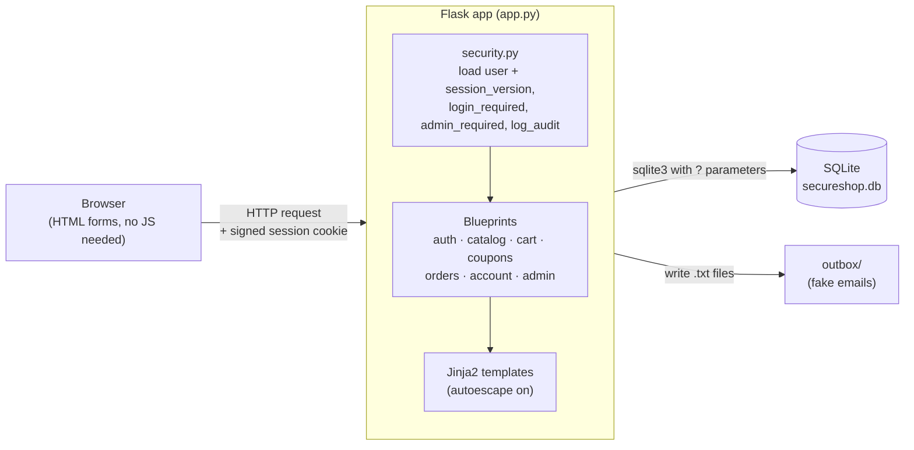
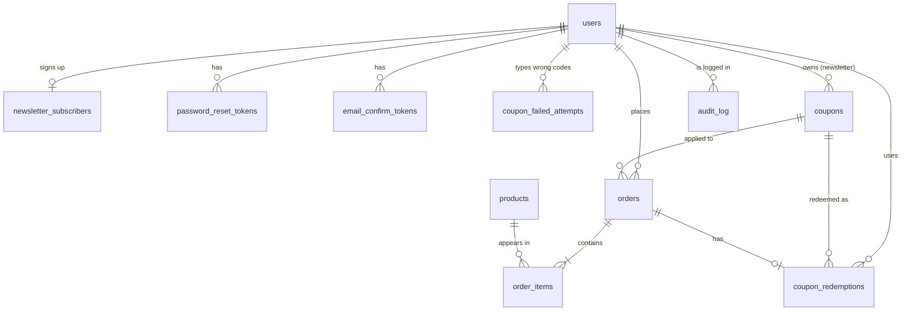

# 01 – Requirements and Design

SecureShop is a small online shop built for CET431 Software Security. The goal
is to show that a normal e‑commerce site can be built so that it resists the
attacks taught in the course (business‑logic flaws, authentication attacks,
SQL injection, XSS, IDOR).

**Tech stack:** Python 3, Flask, SQLite (built‑in `sqlite3`), Jinja2 templates,
`argon2-cffi` (password hashing), `pyotp` (2FA codes). No ORM, no CSS framework,
no JavaScript framework. (`requests` is used only by the attack scripts, not by the app.)

---

## 1. Features

| # | Feature | What the user can do |
|---|---------|----------------------|
| F1 | Registration and login | Create an account (username, email, password), confirm the email (link in `outbox/`), log in, log out, reset a forgotten password. Admins also enter a TOTP 2FA code. |
| F2 | Product catalogue | See the product list, search by name, filter by category and price range, sort by name or price, open a product page. |
| F3 | Shopping cart | Logged‑in users add a product, change the quantity, remove it. The menu shows the number of items. |
| F4 | Coupons and newsletter | Apply one coupon code on the cart page (checked again at payment). Signing up to the newsletter gives a personal coupon. |
| F5 | Checkout and orders | Pay with store credit, see the order confirmation, see order history and order details. |
| F6 | User account | View the profile and credit, change full name and shipping address, change the password. |
| F7 | Admin panel | Users (search, enable/disable, role, credit with a reason), products (add, edit, hide/show), coupons (create, edit, deactivate), read‑only audit log. |
| F8 | Usability | Clear navigation on every page, a flash message after every form, friendly error pages, works on phone and desktop. |

There is no real email server. Every "sent" email is written as a text file to
the `outbox/` folder.

### Business rules (these are also security rules)

- **Prices come from the database only.** The browser sends a product id and a quantity, never a price. Prices are read again inside the payment.
- **Quantity** must be a whole number from 1 to 10 per product, and not more than the stock.
- **One coupon per order.** Each user can use a given code **once**. A coupon can have a minimum cart total, a maximum discount and a maximum number of uses. Percent coupons are 1–30 %. Fixed coupons are limited by their maximum discount and the cart total. A discount is never more than the cart total.
- At most **10 wrong coupon codes** per user in 10 minutes.
- The coupon is checked **again inside the payment**, and the redemption is saved only when the payment succeeds.
- **Store credit can never go below zero.** Payment fails if the credit is too low. One checkout can create at most one order (no double payment).
- An order is created only by the payment, already `paid`. The confirmation page only shows a `paid` order owned by the logged‑in user; it never creates or changes an order.
- New accounts always get the role `user`. Only an admin can make someone an admin; a new admin gets a TOTP secret and must log in again with 2FA.
- An admin cannot change their own role or disable themselves, and the last admin cannot be removed.
- Input that is too long, empty or of the wrong type is **rejected with a clear message**. It is never silently cut.
- The newsletter needs a logged‑in, confirmed account (one signup per account and per email).
- Logging out, changing or resetting the password, changing the role or disabling the account ends all old sessions (`session_version`).

---

## 2. Pages

| URL | Method | Page / action | Login? | File |
|-----|--------|---------------|--------|------|
| `/` | GET | Home page | No | `app.py` |
| `/auth/register` | GET, POST | Registration form | No | `auth.py` |
| `/auth/confirm/<token>` | GET | Confirm email link | No | `auth.py` |
| `/auth/login` | GET, POST | Login form | No | `auth.py` |
| `/auth/two-factor` | GET, POST | TOTP code (admins) | Password step done | `auth.py` |
| `/auth/logout` | POST | Log out | Yes | `auth.py` |
| `/auth/forgot-password` | GET, POST | Ask for a reset link | No | `auth.py` |
| `/auth/reset/<token>` | GET, POST | Choose a new password | No (token) | `auth.py` |
| `/products/` | GET | Product list, `?q=` search, `?category=`, `?min_price=`, `?max_price=`, `?sort=` (`name`, `price_asc`, `price_desc`) | No | `catalog.py` |
| `/products/<id>` | GET | Product details + add to cart | No | `catalog.py` |
| `/cart/` | GET | Cart + coupon form | Yes | `cart.py` |
| `/cart/add`, `/cart/update`, `/cart/remove` | POST | Change the cart | Yes | `cart.py` |
| `/coupons/apply`, `/coupons/remove` | POST | Apply / remove the coupon | Yes | `coupons.py` |
| `/newsletter` | GET, POST | Newsletter signup | Yes | `coupons.py` |
| `/checkout` | GET | Review order and total | Yes | `orders.py` |
| `/checkout/pay` | POST | Pay with store credit (`checkout_token`) | Yes | `orders.py` |
| `/orders` | GET | My orders | Yes | `orders.py` |
| `/orders/<public_id>` | GET | One order (own orders only) | Yes | `orders.py` |
| `/orders/<public_id>/confirmation` | GET | Confirmation (paid + own order) | Yes | `orders.py` |
| `/account/` | GET | My profile and credit | Yes | `account.py` |
| `/account/edit` | GET, POST | Edit name and shipping address | Yes | `account.py` |
| `/account/password` | GET, POST | Change password | Yes | `account.py` |
| `/admin/` | GET | Admin dashboard | Admin + 2FA | `admin.py` |
| `/admin/users` | GET | List / search users | Admin + 2FA | `admin.py` |
| `/admin/users/<id>/toggle-disabled`, `/role`, `/credit` | POST | Enable/disable, change role, adjust credit | Admin + 2FA | `admin.py` |
| `/admin/products`, `/admin/products/new`, `/admin/products/<id>/edit` | GET (+POST) | List, add, edit products | Admin + 2FA | `admin.py` |
| `/admin/products/<id>/toggle` | POST | Hide / show a product | Admin + 2FA | `admin.py` |
| `/admin/coupons`, `/admin/coupons/new`, `/admin/coupons/<id>/edit` | GET (+POST) | List, create, edit coupons | Admin + 2FA | `admin.py` |
| `/admin/coupons/<id>/toggle` | POST | Deactivate / activate a coupon | Admin + 2FA | `admin.py` |
| `/admin/audit` | GET | Audit log (latest 200, `?action=` filter) | Admin + 2FA | `admin.py` |

Actions that **change data** use **POST**, never GET. Every page is reachable
from the menu (Products, Cart, Orders, My Account, Admin, Log in/Register/Log out)
or from a link on a page reached from the menu.

---

## 3. Architecture

**One request, step by step:**

1. The browser sends a request with the signed session cookie.
2. `security.load_logged_in_user()` reads `user_id` and `session_version` from the session, loads the user (role, credit, disabled flag) from the database into `g.user`, and drops the session if the version is old or the account is disabled.
3. The blueprint route runs. `@login_required` / `@admin_required` stop it early if the user may not be there (admin also needs `session["mfa_done"]`).
4. The route validates the input (reject, never cut) and reads/writes the database with `?` placeholders only. Payment runs in one `BEGIN IMMEDIATE` transaction.
5. Security events are written with `log_audit()`.
6. A Jinja2 template builds the HTML page. Autoescaping turns `<script>` into harmless text.
7. Errors (400/403/404/405/413/500) show a friendly page from `error.html`, never a stack trace.

**Files:**

| File | Purpose |
|------|---------|
| `app.py` | Creates the Flask app, registers blueprints, error pages, `money` filter, cart count for the menu, home page |
| `config.py` | All settings and limits (max lengths, lockout, tokens, coupons) in one place |
| `db.py` | `get_db()`, `close_db()`, `query_one()`, `query_all()` |
| `security.py` | `load_logged_in_user`, `bump_session_version`, `login_required`, `admin_required`, `log_audit`, `client_ip` |
| `auth.py` … `admin.py` | One blueprint per feature (see section 5) |
| `schema.sql` | All tables with CHECK and UNIQUE constraints |
| `seed.py` | Creates the database with test users, products and coupons |
| `common_passwords.txt` | ~100 passwords that are refused |
| `templates/` | `base.html` (layout + menu), `index.html`, `error.html`, and one folder per feature |
| `static/style.css` | Simple responsive styles |
| `tests/` | `unittest` tests, one file per feature (113 tests) |
| `naive_demo/` | **Vulnerable on purpose** demo app for the attack evidence – never imported by SecureShop |
| `attack_scripts/` | One attack per topic against both apps, `run_all.py` |

---

## 4. Database tables

Money is stored as **whole cents** (`INTEGER`), e.g. $1,337.00 = `133700`, so
there are no rounding problems. Token expiry times are Unix seconds.

| Table | What it stores | Important rules |
|-------|----------------|-----------------|
| `users` | username, email, name, shipping address, Argon2id hash, role, confirmed / disabled flags, store credit, TOTP secret and last used step, failed‑login counter, lock time, number of locks, `session_version` | `role IN ('user','admin')`, `store_credit_cents >= 0`, username and email unique (case‑insensitive), max lengths |
| `products` | name, description, category, price, stock, active flag | `price_cents > 0`, `stock >= 0`; hidden instead of deleted |
| `coupons` | code, type (`percent`/`fixed`), value, max discount, minimum cart total, max uses, active flag, expiry, optional owner (newsletter coupons) | percent 1–30, fixed > 0, code unique (case‑insensitive), 3–32 characters |
| `orders` | random `public_id`, `checkout_token`, owner, status, subtotal, discount, total, the one coupon used, paid time | `public_id` and `checkout_token` UNIQUE, `status IN ('pending','paid','cancelled')`, `total = subtotal - discount`, discount ≤ subtotal |
| `order_items` | products in an order with the price **copied from the database** at payment time | `quantity BETWEEN 1 AND 10`, `unit_price_cents > 0` |
| `coupon_redemptions` | which user used which coupon on which order | `UNIQUE(coupon_id, user_id)`, `order_id UNIQUE` |
| `newsletter_subscribers` | who signed up and which personal coupon they got | `user_id UNIQUE`, `email UNIQUE` |
| `coupon_failed_attempts` | one row per wrong coupon code (user, time) | for the 10‑per‑10‑minutes limit |
| `password_reset_tokens` | SHA‑256 hash of each reset token, expiry (15 min), used time | single use, only the hash is stored |
| `email_confirm_tokens` | SHA‑256 hash of each confirmation token, expiry (24 h), used time | single use, only the hash is stored |
| `login_attempts` | every login try: username, IP, success, time | also for usernames that do not exist |
| `audit_log` | who did what and when (user, action, details, IP) | never contains passwords, tokens or codes |

---

## 5. Team ownership

| Member | File(s) | Feature |
|--------|---------|---------|
| Member 1 | `auth.py`, `templates/auth/`, `tests/test_auth.py`, `common_passwords.txt` | Registration, email confirmation, login, lockout, admin 2FA, logout, password reset |
| Member 2 | `catalog.py`, `templates/catalog/`, `tests/test_catalog.py` | Product list, search, filter, sort, details |
| Member 3 | `cart.py`, `templates/cart/`, `tests/test_cart.py` | Session cart: add, change quantity, remove |
| Member 4 | `coupons.py`, `templates/coupons/`, `tests/test_coupons.py` | Coupons, guessing limit, newsletter coupon |
| Member 5 | `orders.py`, `templates/orders/`, `tests/test_orders.py` | Checkout, payment transaction, confirmation, history |
| Member 6 | `account.py`, `admin.py`, `templates/account/`, `templates/admin/`, `tests/test_account.py`, `tests/test_admin.py` | Account page, admin panel |
| Member 7 | `app.py`, `db.py`, `security.py`, `config.py`, `schema.sql`, `seed.py`, `templates/base.html`, `index.html`, `error.html`, `static/`, `tests/base.py`, `docs/`, `naive_demo/`, `attack_scripts/` | Shared base, threat model, matrix, naive demo app and attack evidence |

Each member's own explanation (in Arabic) is in `docs/team/memberN.md`; the
commit order is in `docs/GIT_PLAN.md`.
