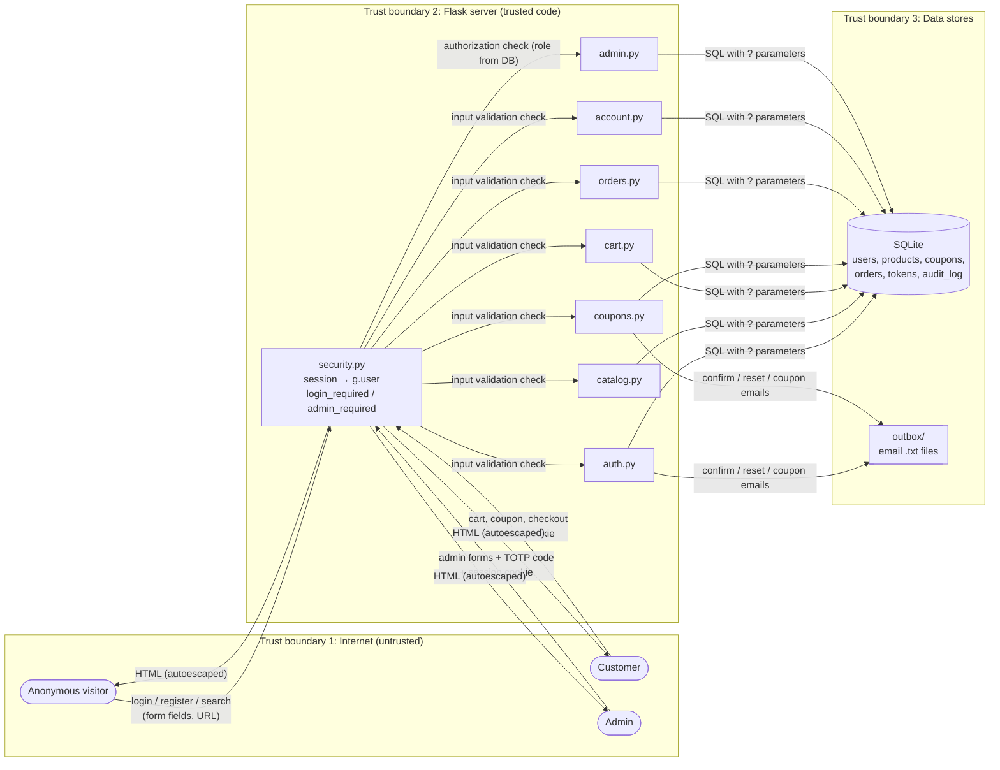

# 02 – Threat Model

Method: the four questions from Lecture 2
(**Plan** – what are we building? → **Model** – what can go wrong? →
**Mitigate** – what do we do about it? → **Validate** – did we do a good job?).
We use **STRIDE** to find threats and **DREAD** to rank them.

> Status: end of Phase 1 – **all defenses below are built**. Each threat maps to
> a row in [`03_security_coverage_matrix.md`](03_security_coverage_matrix.md),
> and the attacks are shown working on the naive app and failing on SecureShop in
> [`04_attack_evidence.md`](04_attack_evidence.md). Threats marked **New** were
> found while building the features.

---

## 1. Assets (what we protect)

| Asset | Why it matters | Property |
|-------|----------------|----------|
| User accounts and passwords (hashes) | Account takeover, reuse of passwords on other sites | Confidentiality, Authentication |
| Admin accounts and TOTP secrets | Full control of the shop | Authentication, Authorization |
| Store credit balances | This is "money" in the shop | Integrity |
| Product prices and stock | Changing them = stealing goods | Integrity |
| Coupons and their usage records | Unlimited discounts = lost money | Integrity |
| Orders and order history | Personal data, proof of purchase | Confidentiality, Integrity, Non‑repudiation |
| Personal data (name, email) | Privacy | Confidentiality |
| Reset and confirmation tokens | Whoever has one can take over or confirm an account | Confidentiality |
| Session cookie and `SECRET_KEY` | Whoever has the key can forge any session | Confidentiality, Authentication |
| Audit log | Proves who did what | Integrity, Non‑repudiation |
| The site being up | Customers cannot shop if it is down | Availability |

---

## 2. Entry points (everything an attacker can send)

**Every request also carries:** the `session` cookie, the HTTP headers and the
client IP. Any of these can be changed by the attacker (Lab 1: use Burp Repeater).

| Entry point | Method | Parameters the client controls | Who can reach it |
|-------------|--------|--------------------------------|------------------|
| `/auth/register` | POST | `username`, `email`, `password`, `confirm_password` (+ any extra field an attacker adds, e.g. `role`) | Anyone |
| `/auth/confirm/<token>` | GET | `token` in the URL | Anyone |
| `/auth/login` | POST | `username`, `password` | Anyone |
| `/auth/two-factor` | POST | `code` (6 digits) (+ fake `user`, `user_id`, `verify` cookie) | After password step |
| `/auth/logout` | POST | – | Logged in |
| `/auth/forgot-password` | POST | `email` | Anyone |
| `/auth/reset/<token>` | GET, POST | `token` in URL, `password`, `confirm_password` | Anyone with a link |
| `/products/` | GET | `q`, `category`, `min_price`, `max_price`, `sort` | Anyone |
| `/products/<id>` | GET | `id` in URL | Anyone |
| `/cart/` | GET | – | Logged in |
| `/cart/add`, `/cart/update` | POST | `product_id`, `quantity` (+ fake `price`, `total`) | Logged in |
| `/cart/remove` | POST | `product_id` | Logged in |
| `/coupons/apply` | POST | `code` | Logged in |
| `/coupons/remove` | POST | – | Logged in |
| `/newsletter` | GET, POST | – (the account email is used, no form field) | Logged in |
| `/checkout` | GET | – | Logged in |
| `/checkout/pay` | POST | `checkout_token` (+ fake `total`, `price`, `user_id`) | Logged in |
| `/orders` | GET | – | Logged in |
| `/orders/<public_id>`, `/orders/<public_id>/confirmation` | GET | `public_id` in URL | Logged in |
| `/account/` | GET | – | Logged in |
| `/account/edit` | POST | `full_name`, `shipping_address` (+ fake `role`, `store_credit_cents`, `email`, `user_id`) | Logged in |
| `/account/password` | POST | `current_password`, `new_password`, `confirm_password` | Logged in |
| `/admin/users` | GET | `q` | Admin + 2FA |
| `/admin/users/<id>/toggle-disabled`, `/role`, `/credit` | POST | `role`; `amount`, `reason` | Admin + 2FA |
| `/admin/products`, `/new`, `/<id>/edit`, `/<id>/toggle` | GET, POST | `name`, `description`, `category`, `price`, `stock` | Admin + 2FA |
| `/admin/coupons`, `/new`, `/<id>/edit`, `/<id>/toggle` | GET, POST | `code`, `discount_type`, `discount_value`, `max_discount`, `min_total`, `max_uses`, `expires` | Admin + 2FA |
| `/admin/audit` | GET | `action` | Admin + 2FA |
| `outbox/` folder | file system | – | Server only (not served on the web) |

---

## 3. Attacker types

| Attacker | Can do | Typical goal |
|----------|--------|--------------|
| **Anonymous visitor** | Browse, register, try logins, send any request with Burp | SQL injection in search, brute‑force logins, abuse password reset, register an account as admin |
| **Logged‑in customer** | Everything a user can do + edit their own requests | Change prices, stack coupons, skip payment, negative quantities, read other people's orders (IDOR), stored XSS in their name |
| **Malicious admin‑wannabe** | A normal account trying to become admin | Open `/admin/...` URLs directly, send `role=admin` in a form, edit the session cookie, use a long‑email trick (Lab 2.2), break the 2FA step (Lab 3) |

Out of scope: attackers with access to the server, its files, or the network
between the user and the server (we note HTTPS as a deployment requirement).

---

## 4. Data flow diagram with trust boundaries

A trust boundary is where the trust level changes. **Any data crossing a
trust boundary must be treated as hostile** (Lecture 2).

**Where the checks happen:**

| Boundary crossing | Check |
|-------------------|-------|
| Browser → Flask (1 → 2) | Validate every field (type, length, range). Ignore fields we did not ask for (price, total, role, user_id). Session cookie must have a valid signature. |
| Flask → admin routes | `@admin_required` reads the role **from the database** each time. |
| Flask → SQLite (2 → 3) | Parameterized queries only. CHECK constraints refuse bad values. |
| Flask → Browser (2 → 1) | Jinja2 autoescaping, generic error pages, no stack traces. |
| Flask → outbox | Only the server writes there. The folder is not served over HTTP. |

---

## 5. STRIDE per feature

S = Spoofing, T = Tampering, R = Repudiation, I = Information disclosure,
D = Denial of service, E = Elevation of privilege.

### F1 – Registration and login (`auth.py`)

| STRIDE | Threat in SecureShop | Defense |
|--------|----------------------|-----------------|
| S | Brute‑force or credential stuffing on `/auth/login` | Count failures, lock with growing delay, `login_attempts` table |
| S | Lab 3: after the password step, change the user id/name in the request or cookie to reach someone else's 2FA step | Identity kept only in the signed session (`pending_2fa_user_id`), never read from the request |
| S | Reuse an old or sniffed TOTP code | `valid_window=1`, store `totp_last_step`, reject a step that is not newer, limit attempts |
| S | Guess or reuse a reset link | `secrets.token_urlsafe(32)`, stored as SHA‑256, expires after 15 min, single use |
| T | Registration form sends `role=admin` | Role is always `'user'` in the INSERT; extra fields ignored |
| E | Lab 2.2: a very long email cut to `...@secureshop.com` gives admin | Reject emails over 254 characters (never cut); role never comes from the email domain |
| I | "Wrong password" vs "No such user" tells the attacker which emails exist | One generic message; forgot‑password always shows the same reply |
| I | Stolen database reveals passwords | Argon2id hashes; tokens stored as hashes |
| R | User denies a login, or failed logins go unnoticed | `audit_log` rows for login_success, login_failed, account_locked, logout |
| D | Attacker locks real users out on purpose | Lock is temporary (1 min, doubling, max 30 min), not permanent; a password reset unlocks |

### F2 – Product catalogue (`catalog.py`)

| STRIDE | Threat | Defense |
|--------|--------|-----------------|
| T / I | SQL injection in `?q=` or `?category=` (e.g. `' OR 1=1 --`, `UNION SELECT password_hash FROM users`) | `?` placeholders; `LIKE ?` with the `%` added in Python |
| T | Reflected XSS: search text shown back on the page | Jinja2 autoescaping, no `|safe` |
| I | Hidden (inactive) products shown by guessing `/products/<id>` | Query includes `AND is_active = 1`; otherwise 404 |
| D | Very long search strings | Max 100 characters, request body max 1 MB |
| T / I | **New:** SQL injection through `?sort=` – `ORDER BY` cannot use a `?` placeholder, so a naive `"ORDER BY " + sort` is injectable | Fixed allow‑list `SORT_OPTIONS` in `catalog.py`; the user sends a key, the SQL text comes from our dict; unknown keys fall back to `name` |
| T | **New:** Odd price filters (`-5`, `1e9`, `nan`, `abc`) give errors or surprising results | Regex for a plain non‑negative number with max 2 decimals, max $1,000,000, min ≤ max; otherwise a friendly 400 message |

### F3 – Shopping cart (`cart.py`)

| STRIDE | Threat | Defense |
|--------|--------|-----------------|
| T | Lab 1: send `price=1` with the add‑to‑cart request | Cart stores only `{product_id: quantity}`; price always read from `products` |
| T | Negative, zero, huge or text quantities (`-5`, `0`, `9999`, `abc`) to make the total negative | Whole number 1–10 only, else error message; CHECK constraint on `order_items` |
| T | Add a product id that does not exist or is inactive | Look up the product; reject if not found or inactive |
| T | Edit the session cookie to change the cart | Cookie is signed with `SECRET_KEY`; any change breaks the signature |
| T | **New:** Order more than is in stock, or keep a product that was later hidden | Quantity must also be ≤ stock; the cart is rebuilt from the database on every view – hidden products are removed and quantities lowered, with a message |

### F4 – Coupons and newsletter (`coupons.py`)

| STRIDE | Threat | Defense |
|--------|--------|-----------------|
| T | Lab 2.1: alternate two codes to stack discounts | Only one code in the session; `orders.coupon_id` is one column; `coupon_redemptions.order_id` UNIQUE |
| T | Use the same code again on a new order | `UNIQUE(coupon_id, user_id)` + check before paying |
| T | Use an expired / inactive coupon, or someone else's newsletter coupon | Check `is_active`, `expires_at`, `owner_user_id` at apply **and** at payment |
| T | Coupon gives more than 100 % off | Percent coupons 1–30 % (admin validation + CHECK); every discount is capped by the cart total, so the total can never be below 0 |
| S | Farm newsletter coupons with many fake emails | Newsletter needs a logged‑in account; one signup per account (`user_id UNIQUE`) |
| R | Customer denies using a coupon | `audit_log` "coupon_redeemed" + `coupon_redemptions` row |
| S / I | **New:** Guess coupon codes (e.g. Burp Intruder over `NEWS-…` or common words) to find other people's personal coupons | Newsletter codes are 40‑bit random (`secrets`) and work only for their owner; max 10 wrong codes per user in 10 minutes (`coupon_failed_attempts`), then all codes are refused; `coupon_rejected` / `coupon_guessing_blocked` in `audit_log` |
| T | **New:** A big fixed‑amount coupon on a small cart makes the total negative | Fixed discount capped by the coupon's `max_discount_cents` and by the cart total (total can reach $0, never below); `orders` CHECK `discount ≤ subtotal` |

### F5 – Checkout and orders (`orders.py`)

| STRIDE | Threat | Defense |
|--------|--------|-----------------|
| T | Lab 2.3: open `/orders/<id>/confirmation` without paying | Order status kept on the server; confirmation only if `status='paid'` |
| T | Send a fake `total` or `price` to `/checkout/pay` | Total recalculated from the database inside the payment step |
| T | Pay twice at the same time (double click / two tabs) to overspend credit | `BEGIN IMMEDIATE` transaction; `UPDATE users SET store_credit_cents = store_credit_cents - ? WHERE id = ? AND store_credit_cents >= ?`; CHECK `>= 0` |
| T | **New:** replay the same pay request (double click, Burp Repeater, an old copy of the session cookie) so ONE checkout creates TWO orders | One‑time `checkout_token` from the checkout page; `orders.checkout_token` is UNIQUE and checked inside the transaction – the second request is sent to the first order |
| I | **New:** guess order URLs `/orders/1, 2, 3 …` | Random `public_id` (`secrets.token_urlsafe(12)`) plus the owner check |
| I | IDOR: change `/orders/5` to `/orders/6` to see another person's order | Random `public_id` and `WHERE public_id = ? AND user_id = ?`; otherwise 404 |
| R | Customer says "I never ordered this" | `audit_log` "order_placed" with the order id, total and discount; `paid_at` time |

### F6 – User account (`account.py`)

| STRIDE | Threat | Defense |
|--------|--------|-----------------|
| E | Add `role=admin` or `store_credit_cents=99999` to the edit form | Only `full_name` (and password with current password) are updated |
| I | IDOR on profile | No user id in any URL; always `g.user` |
| T | Stored XSS in the name (`<script>...`) shown on admin pages | Autoescaping everywhere, no `|safe`; max length 100 |
| S | Someone at an unlocked computer changes the password | Current password required to set a new one |

### F7 – Admin panel (`admin.py`)

| STRIDE | Threat | Defense |
|--------|--------|-----------------|
| E | Normal user opens `/admin/users` directly | `@admin_required` on every route, role read from the database; 403 + audit row |
| S | Stolen admin password | TOTP 2FA required for admins |
| T | Admin sets price 0, negative credit, 90 % coupon | Server validation + CHECK constraints (`price > 0`, `credit >= 0`, discount 1–30) |
| R | Admin denies changing a price or giving credit | Every admin change logged in `audit_log` (who, what, old → new) |
| E | Admin removes their own admin role by mistake / last admin removed | An admin cannot change their own role or disable themselves; the last active admin cannot be removed |
| E | **New:** a user who is made admin while logged in uses admin pages without ever doing 2FA | Admin pages need `session["mfa_done"]`; a role change bumps `session_version`, so the user must log in again (with the new TOTP secret, shown once) |
| I | **New:** the new admin's TOTP secret leaks (flash message in the cookie, browser cache, audit log) | Shown once on the response page only, `Cache-Control: no-store`, never logged |

### Cross‑cutting

| STRIDE | Threat | Defense |
|--------|--------|-----------------|
| I | Stack trace with code and paths shown on an error | `DEBUG = False`, custom `error.html` for 400/403/404/405/413/500 |
| S | Forged session cookie | Random `SECRET_KEY` (from environment in production) |
| I | Session cookie stolen by JavaScript | `SESSION_COOKIE_HTTPONLY = True`, `SameSite=Lax`, 30‑minute lifetime |
| D | Huge request bodies | `MAX_CONTENT_LENGTH = 1 MB` |
| S | **New:** a copied session cookie keeps working after logout or a password change (Flask cookies are not stored on the server) | `users.session_version` is stored in the session and compared on every request; logout, password change/reset, role change and disabling the account increase it |

---

## 6. DREAD scores for the top threats

Each factor is scored **1 (low) to 10 (high)**: **D**amage, **R**eproducibility,
**E**xploitability, **A**ffected users, **D**iscoverability. Risk = average.

> Note: Lecture 2 points out that DREAD is subjective (Microsoft stopped using
> it internally). We use it only to decide **what to build and test first**.

| ID | Threat | D | R | E | A | Di | **Risk** | Priority |
|----|--------|---|---|---|---|----|----------|----------|
| T1 | Price tampering in cart/checkout (Lab 1) | 8 | 10 | 9 | 10 | 10 | **9.4** | High |
| T2 | SQL injection in search / login | 10 | 10 | 7 | 10 | 8 | **9.0** | High |
| T3 | Coupon stacking / reuse (Lab 2.1) | 7 | 10 | 9 | 10 | 9 | **9.0** | High |
| T4 | Negative quantity → negative total / infinite credit | 8 | 10 | 9 | 10 | 8 | **9.0** | High |
| T5 | IDOR on `/orders/<id>` | 6 | 10 | 9 | 10 | 9 | **8.8** | High |
| T6 | Order confirmation without payment (Lab 2.3) | 8 | 10 | 8 | 10 | 7 | **8.6** | High |
| T7 | Privilege escalation (`role=admin` in a form, or missing admin check) | 10 | 10 | 6 | 10 | 6 | **8.4** | High |
| T8 | Stack trace / debug console exposed | 6 | 10 | 8 | 10 | 8 | **8.4** | High |
| T9 | Online brute force / credential stuffing on login | 8 | 8 | 7 | 8 | 10 | **8.2** | High |
| T10 | Long‑email truncation → admin (Lab 2.2) | 9 | 10 | 6 | 10 | 5 | **8.0** | Medium |
| T11 | Stored XSS in name / product text | 8 | 9 | 6 | 9 | 7 | **7.8** | Medium |
| T12 | Missing audit trail (repudiation) | 5 | 10 | 8 | 10 | 5 | **7.6** | Medium |
| T13 | Broken 2FA logic (Lab 3) | 10 | 9 | 7 | 3 | 6 | **7.0** | Medium |
| T14 | Password reset token guessed / reused | 9 | 6 | 5 | 7 | 5 | **6.4** | Medium |
| T15 | SQL injection through the `sort` parameter (`ORDER BY`) – *found while building the catalogue* | 10 | 10 | 6 | 10 | 5 | **8.2** | High |
| T16 | Coupon code guessing with Intruder – *found while building coupons* | 4 | 8 | 7 | 6 | 7 | **6.4** | Medium |
| T17 | Replayed pay request creates two orders – *found while building checkout* | 7 | 9 | 7 | 10 | 6 | **7.8** | Medium |
| T18 | Copied session cookie still works after logout / password change – *found while building accounts* | 8 | 7 | 5 | 8 | 4 | **6.4** | Medium |
| T19 | User promoted to admin while logged in skips 2FA – *found while building admin* | 9 | 6 | 4 | 3 | 3 | **5.0** | Low |

**What this means for the build order:** the cart/checkout/coupon logic
(T1, T3, T4, T6) and parameterized queries (T2) must be correct from the first
version, because they are the easiest to find and the most damaging.

---

## 7. Validate (how we will check)

For every threat above we will:

1. Try the attack ourselves with the browser and Burp Suite (Proxy, Repeater, Intruder) – the same way as in Labs 1–3.
2. Save the evidence (screenshot of the refused request, or the audit_log row).
3. Update the **Evidence** and **Status** columns in `03_security_coverage_matrix.md`.
